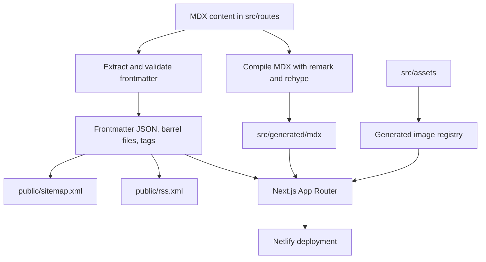

# Codebase review — 23 October 2026

The site has a sensible shape for a personal technical blog: content lives in Git, most work happens at build time, and React is available for interactive examples. The biggest opportunity is to make content generation and verification dependable. Several of the planned features can then share that foundation.

This review covers application routes, the content generators, shared components, demos, tests, CI, deployment configuration, dependencies, and the separate diagram tool. Recommendations below distinguish reproduced defects from improvements and future failure cases. Application code and TODO.md were left unchanged.

## How the codebase works

There are **83 published posts, 10 drafts, and 7 test articles** under `src/routes`. Those directories contain content, despite the name; Next.js routing lives under `src/app`.

| Area | Main files | Responsibility |
| --- | --- | --- |
| Content compilation | [transformMdx.ts](utils/transformMdx.ts) | Compile MDX into JavaScript; syntax highlighting, heading IDs, exported frontmatter. |
| Content indexing | [extractFrontMatter.ts](utils/extractFrontMatter.ts), [frontmatterTypings.ts](utils/frontmatterTypings.ts) | Parse YAML, validate it with Zod, write JSON and export indexes, build tag membership. |
| Content access | [blogPosts.tsx](src/utils/blogPosts.tsx) | Load compiled posts, look up metadata, sort posts, assemble series, produce social metadata. |
| Routes | [src/app](src/app) | Home, post/tag listings, article pages, gated draft/test pages, informational pages, demos. |
| Article chrome | [BlogPostFrame](src/components/BlogPostFrame/BlogPostFrame.tsx), [FrontmatterBox](src/components/FrontmatterBox/FrontmatterBox.tsx) | Title/date, series navigation, GitHub edit link, comments. |
| Interactive examples | [src/demos](src/demos) | Rendering behaviour, cookies, caching, confirmation dialogs, state encapsulation. |
| External integrations | [layout.tsx](src/app/layout.tsx), instrumentation files, [PostComments](src/components/PostComments/PostComments.tsx) | GitHub code embeds, margin highlights, Utterances, Google Analytics, Sentry. |
| Diagram authoring | [src/image-gen](src/image-gen/README.md) | Separate package that bundles diagram modules and uses headless Chrome to export PNG and editable Excalidraw files. |
| Verification/deployment | [static-checks.yml](.github/workflows/static-checks.yml), [netlify.toml](netlify.toml) | Build, lint, types, unit tests, Netlify hosting. Browser-test workflow currently disabled. |

There is no database or general application backend. The route handlers are small demonstrations of caching and cookies. Some article content is request-dependent, notably the server-cookie example, so the site should not be assumed to be entirely static.

Useful existing choices include strict TypeScript, schema validation at the content boundary, real article fixtures for browser tests, shared article framing, and editable source files alongside generated diagrams. These are good foundations to retain.

## What I verified

| Check | Result and limits |
| --- | --- |
| Unit tests | `npm test -- --run`: **4 tests passed**, across the two generator test files. |
| Lint | `npm run lint`: **0 errors, 6 warnings**, concerning fonts, analytics script loading, and error-page images. |
| Types | Failed in the three Sentry initialization files because the installed SDK does not recognise `enableLogs`. The first TypeScript command fails, so the Cypress type check is not reached. |
| Content generation | All five generation stages completed in a temporary copy, invoked through `node --import tsx` because the sandbox prevents the tsx CLI's IPC socket. Generated RSS and sitemap each contain **83 entries** and parse as XML. |
| Production build | Attempted in the temporary copy using the existing installed dependencies. Failed fetching Inter from `fonts.googleapis.com` because DNS/network access is unavailable here. This does not establish a production build defect. |
| Browser tests | Not run. No claim of browser, deployment, visual, or accessibility verification. |
| Content checks | All current content has parseable dates and existing social-image references. A lightweight scan found no broken internal post links; it was not a complete MDX link/anchor validator. |

The dependency state matters when interpreting these results:

| Package | Manifest/lockfile target | Installed locally |
| --- | --- | --- |
| Next.js | `^16.2.6` / `16.2.6` | `15.5.4` |
| Sentry Next.js SDK | `^10.53.1` / `10.53.1` | `9.34.0` |
| Next MDX package | `^14.2.4` / `14.2.4` | `14.2.4` |
| Next ESLint configuration | `14.2.4` | `14.2.4` |

The manifest and lockfile agree on the upgraded Next/Sentry versions; local `node_modules` is behind them. A fresh installation of the locked dependency tree was not performed. Therefore the observed Sentry type failures should first be investigated as installation drift, rather than by deleting valid options from the source.

## Work to prioritise

### 1. Repair the exported Next.js configuration

**Confirmed defect; small change, with build verification required.**

[next.config.js](next.config.js) declares `nextConfig`, but passes `module.exports` into `withSentryConfig`. At that point `module.exports` is the initial empty object. I evaluated the configuration with a stub wrapper and confirmed its input is `{}`.

Consequently the declared compiler settings, external packages, and custom webpack warning handling are discarded. Pass the declared configuration to the wrapper.

Make this part of finishing the Next 16 migration: `reactCompiler` moved to the top level, and Next 16 defaults to Turbopack. Restoring the custom webpack function requires an explicit bundler decision. Keep annotation mode deliberately scoped because automatic memoization could change the behaviour being illustrated by the React rendering demos. See the official [Next 16 migration guide](https://nextjs.org/docs/app/guides/upgrading/version-16) and [compiler configuration](https://nextjs.org/docs/app/api-reference/config/next-config-js/reactCompiler).

**Done when:** a fresh locked install passes build/types and the effective configuration contains the intended options; rendering demos still illustrate their documented behaviour.

### 2. Make generation await writes and produce repeatable output

**Confirmed defect plus robustness improvements; medium scope.**

The default writer in [transformMdx.ts](utils/transformMdx.ts) calls `fs.writeFile` without returning or awaiting its promise. I delayed those writes and observed compilation return with **four writes pending and zero completed**. Callers cannot rely on completion, and write failures are detached from the compiler's promise.

Other generation issues become especially relevant to live reload:

- Frontmatter barrel files are appended to. The npm command removes the old directory first, but the underlying generator cannot safely be rerun against existing output.
- Concurrent file processing appends exports in completion order. Sort records and write each index once for stable output.
- Generated exports use filenames directly as JavaScript identifiers. A conventional new filename such as `my-post.mdx` would produce an invalid named export. Support string-keyed records or validate naming constraints clearly.
- The MDX compiler traverses arbitrary nesting, while frontmatter extraction requires exactly two path segments beneath the content root. Decide on one supported layout.
- `generate:all` deletes `.next`, coupling content refresh to clearing the entire framework cache.

**Done when:** generation twice produces identical output, renames/deletions remove stale files, failures reject the command, and tests exercise real temporary-file writes as well as injected callbacks.

### 3. Restore browser checks as part of the Playwright migration

**Confirmed coverage gap; medium scope.**

[cypress.yml](.github/workflows/cypress.yml) has `if: false`. Current browser tests also suppress broad classes of React errors, including any message containing “Minified React error”, and assert exact hashed asset filenames.

Preserve useful coverage while migrating: article navigation, metadata, series, images, comments, and 404s. Add tag filtering, production draft/test gating, and at least one interactive demo. Assert that images load, not just that an element exists: the image fixture currently passes an imported image object directly into a raw ``'s `src`.

Run most tests against a locally built server, then use a smaller deployed smoke suite to check Netlify-specific behaviour. Playwright supports a managed [web server](https://playwright.dev/docs/test-webserver) and [trace configuration](https://playwright.dev/docs/test-configuration).

If retaining the deploy polling script, fix its error check: it compares the HTTP response's `status` to the string `"error"` instead of checking the deployment's `state`. The runner also invokes Yarn despite this being an npm project.

**Done when:** PRs run browser tests, uncaught application errors fail them, failures include diagnostic artifacts, and assertions survive regenerated image hashes.

### 4. Keep missing content separate from broken content

**Confirmed error-handling problems; small to medium scope.**

[getBlogContent](src/utils/blogPosts.tsx) converts every caught import or synchronous component error into `notFound()`. An existing post with a broken import can therefore look like a missing page. `getMetadata` similarly hides all failures behind generic metadata.

Look up whether a slug exists before importing it; let unexpected failures reach the error boundary and Sentry. Render a useful fallback in [global-error.tsx](src/app/global-error.tsx), whose body currently contains only a placeholder comment. Consider making the existing route-level error page's `reset` action available too.

**Done when:** an unknown slug returns 404, a deliberately broken known post reaches a useful error screen, and the original error is observable.

### 5. Establish one validated content model

**Confirmed inconsistencies; medium scope with benefits across several TODOs.**

Frontmatter is parsed twice: once from YAML, once by extracting JSON-shaped text from compiled JavaScript with a regex. One phase requires a publication date before another phase can supply its Git fallback.

[getFileGitTimestamps.ts](utils/getFileGitTimestamps.ts) returns `Invalid Date` for a path without history: splitting empty output yields an array with one empty string, so its empty-history check never triggers. I reproduced this. Git history is queried for every article even when a publication date is already explicit. This also makes generation depend on a Git checkout unnecessarily.

The Zod schema accepts any string as a date; I confirmed `"not-a-date"` passes. Series parts can be fractional, negative, or duplicated. “Next” navigation indexes the sorted series array by part number, assuming uninterrupted numbering from one.

Parse and normalise metadata once, validate actual date values, and build a typed manifest that all consumers share. Validate duplicate series positions and derive the next post from the current post's position. Treat publication date and substantive update date as separate fields; decide explicitly whether Git timestamps are appropriate fallbacks.

This manifest can supply tags, series, RSS, sitemap, search, Markdown exports, and diagram/image metadata.

### 6. Correct public indexes, RSS, and sitemap semantics

**One current indexing defect, one RSS conformance defect, plus preventative work; small to medium scope.**

The tag generator mixes all three content groups. Currently `untagged` contains **5 published posts, 10 drafts, and 7 test articles**. The component compensates by moving that tag last. Generate public tags from published content instead; future draft-specific tags should not appear on the public homepage.

The generated RSS is well-formed XML today, but:

- It is not sorted newest first.
- Titles and descriptions are interpolated without XML escaping. Current metadata happens not to contain the problematic `<` or `&` characters; a future ordinary title could break the feed.
- Its channel image omits required `title` and `link` children. See the [RSS specification](https://www.rssboard.org/rss-specification).

The sitemap uses creation date as `lastmod`, so edits do not change it, and it lists only posts. Include appropriate public informational pages and use an accurate update date, or omit `lastmod` when unavailable. Add RSS autodiscovery, article canonicals, and article-specific metadata through the existing metadata helper. The [Next metadata API](https://nextjs.org/docs/app/api-reference/functions/generate-metadata) supports these fields.

**Done when:** feeds are parsed and validated in tests, punctuation is escaped correctly, sorting is explicit, and public indexes exclude drafts/tests.

### 7. Make builds and checks reproducible

**Observed environment drift and maintenance improvements; small to medium scope.**

Use a locked installation in CI; the current static workflow uses `npm i`. Pin the selected runtime/package manager consistently across local development, CI, and Netlify. Make CI's unit command explicitly noninteractive. Run cheap checks before the production build where their generated-input dependencies allow it.

Review the old Next MDX and lint packages against actual usage. MDX is compiled by the custom utility, so some loader packages may be removable. Do not equate an old version number with a proven incompatibility.

Font handling deserves a specific task: the layout downloads Inter at build time while also loading Open Sans and Material Symbols from Google at runtime. Determine the intended font stack, remove redundant requests, and consider local font assets if offline builds matter. Similarly, syntax-highlighting CSS can be bundled instead of fetched from a CDN.

Remove tracked `tsconfig.tsbuildinfo`, which changes when type checking runs. Clean up unused migration-era utilities such as `buildTimeUtils/generateListOfArticles.ts`, the commented Remix loader, the old social-meta helper, and the unused starter CSS after checking references. Expand the README to explain generation, environment flags, GitHub embeds, tests, deployment, and diagram authoring. `npm start` also relies on a Netlify CLI not declared in this package.

## How I would refine your existing TODOs

| Existing item | Suggested concrete scope |
| --- | --- |
| Switch to Bun | Pin Bun, migrate the lockfile, update CI/Netlify/scripts, verify the Git dependency and install scripts. Decide separately whether Bun is the package manager, script runner, or production runtime. Use a frozen install in CI; see [Bun installation behaviour](https://bun.sh/docs/pm/cli/install) and [lifecycle scripts](https://bun.sh/docs/pm/lifecycle). |
| Switch to Oxlint | Preserve the intent of the current Next rules; explicitly enable appropriate Next/React/accessibility rules and compare diagnostics before removing ESLint. Oxlint has native plugin configuration, including `nextjs`; see its [configuration reference](https://oxc.rs/docs/guide/usage/linter/config). |
| Switch to Playwright | Restore CI coverage, improve assertions, expose runtime errors, capture traces, and test both local builds and a small deployed smoke suite. |
| Add live reload | Watch MDX additions/edits/deletions and relevant assets; refresh compiled content and derived metadata together. Preserve `.next`, report errors without losing the last valid preview, and clean up the watcher on exit. |
| Image panel with description/AI disclaimer | Extend the existing `ImagePanel`, already used by posts. Use `figure`/`figcaption`, concise alt text, visible provenance/credit fields, dimensions, and optional source downloads. |
| Add `.md` page variants | Define readable output for React demos, highlights, GitHub embeds, images, and diagrams. Raw MDX with imports removed still contains JSX. Give unsupported interactive content a descriptive fallback and link to the live page; reuse the same content manifest. |
| Add Mermaid renderer | Prefer generated SVG for ordinary static diagrams; retain Mermaid source for Markdown export. The [official CLI](https://github.com/mermaid-js/mermaid-cli) produces SVG/PNG/PDF. If a client renderer is needed, load it only on relevant pages. |
| Excalidraw renderer? | Much of this exists in `src/image-gen`: Chrome export, local fonts, editable scenes, temporary server cleanup. Extend it with a stable authoring/component interface, previews, source downloads, and regeneration commands before introducing another renderer. |
| Add AGENTS.md files | Start with root instructions explaining setup, generation, checks, and the distinction between content and application routes. Add scoped instructions for content and diagram authoring where needed; include preserving the rendering demos' intended behaviour. Verify commands from a fresh install so agents inherit working instructions. |

For the rendering features, a shared diagram presentation component could provide caption, alt text, source link, and Markdown fallback for both Mermaid and Excalidraw. Prefer keeping the existing heavy diagram dependencies in the authoring package rather than loading an editor for every reader.

## Additional reader-facing work

These are improvements, rather than claims that an observed reader journey failed:

- **Search and an archive.** With 83 posts, title/description/tag search and a year archive would complement the existing topic links. A generated index can do this without a backend. Full-text search can follow if needed.
- **On-page contents and better code reading.** Heading IDs already exist through `rehype-slug`; expose them in a table of contents for long posts. Consider a copy button and preserving code formatting with horizontal scrolling instead of forced wrapping.
- **Accessibility and print layout.** Add a main landmark and skip link; check keyboard focus, long tables/code on mobile, margin annotations, contrast, captions, and printing. The Game of Life cells are clickable divs with `role="button"` but no keyboard handler, accessible name, or tab stop.
- **Image delivery.** Several originals are 1–3 MB and many posts use raw images. Measure actual transfer/layout behaviour before changing formats, then add responsive sizes, dimensions, and appropriate loading behaviour through a shared component. The generated image registry currently excludes nested folders and uppercase extensions such as `.JPG`.
- **External-content resilience.** Test code embeds and comments with third-party requests blocked. Provide meaningful links/fallbacks and make sure article text remains readable. Check comments across navigation and development remounts.
- **Environment-specific telemetry.** Sentry currently sets a trace rate of 1, session replay rate of 0.1, and `sendDefaultPii: true`. Review these explicit choices against the desired diagnostics, data collection, payload, and operating cost; keep preview/development traffic distinguishable.
- **Fix the Game of Life rule.** The implementation kills a live cell with four neighbours but leaves cells with five through eight alive. I exercised the pure logic and reproduced this. Use survival only at two or three neighbours, with small pattern tests for overcrowding, still lifes, and oscillators.

## Suggested delivery order

1. Establish a fresh locked dependency baseline; fix Next config export and finish the bundler/compiler migration.
2. Fix awaited writes, error handling, and metadata/date contracts; make generated output repeatable.
3. Restore browser checks through Playwright and correct public tags/RSS/sitemap behaviour.
4. Add content watching on top of the reliable generator.
5. Share image/diagram metadata and presentation; connect existing Excalidraw tooling and add Mermaid.
6. Add Markdown variants and search using the shared content model; then measure and improve reader performance/accessibility.

Bun and Oxlint can be independent, reviewable changes once the baseline is known. Their speed benefits are useful, but the confirmed configuration, generation, and verification defects deserve earlier attention.
